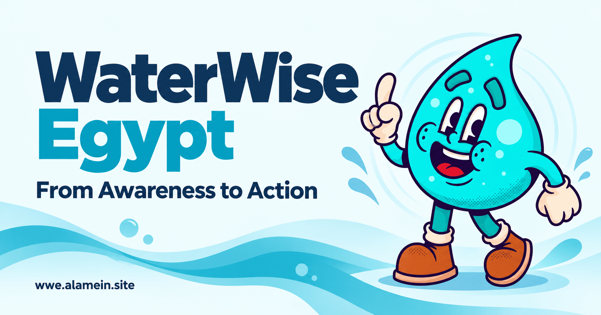

<div align="center">

# 💧 WaterWise Egypt

### From Awareness to Action

**A bilingual, research-informed platform that makes water conservation easier to understand, explore, and practice.**

[](https://wwe.alamein.site)
[](https://wwe.alamein.site/project/WaterWise-Egypt-Research.pdf)

[](https://github.com/Omar-Alshaer/WaterWise-Egypt/actions/workflows/verify.yml)


<a href="https://wwe.alamein.site">
  
</a>

**[Explore the platform](https://wwe.alamein.site)** · **[Read the research](https://wwe.alamein.site/project/WaterWise-Egypt-Research.pdf)** · **[Administration](https://manage.wwe.alamein.site/ar/manage)**

</div>

---

## About the project

**WaterWise Egypt** is an educational web application focused on water conservation and responsible everyday water use. It turns sustainability concepts into approachable lessons, interactive tools, and progress-based activities rather than presenting research as static information alone.

The project was developed for the **Climate Change and Sustainability** course at **Alamein International University (AIU)**, during **Fall 2026**.

It is aligned primarily with **UN Sustainable Development Goal 6 — Clean Water and Sanitation**, with supporting connections to **SDG 12 — Responsible Consumption and Production** and **SDG 13 — Climate Action**.

> **Our mission:** Help people move from awareness to action through accessible information, practical reflection, and achievable water-conscious habits.

## What you can explore

| Experience | What it does |
| --- | --- |
| **Arabic & English** | Two localized experiences with right-to-left Arabic and left-to-right English layouts, designed for mobile and desktop. |
| **Water-use calculator** | Estimates daily water use from user-selected activities and adjustable assumptions. |
| **Leak-check guide** | Interactive, self-reported checks that help users recognize situations worth investigating. |
| **Learn & Quiz** | Practical water-conservation lessons followed by before-and-after knowledge assessments. |
| **Daily challenges** | Four simple habit-focused activities with progress and achievement feedback. |
| **Personal account** | Email/password or Google authentication, profile management, saved estimates, quiz scores, and completed challenges. |
| **Research & references** | A research section connecting the educational experience to scientific literature and the project's published report. |
| **Protected admin workspace** | A dedicated dashboard for authorized administrators to review account activity, inspect user profiles, and manage ordinary account access. |

### See it live

- **Main website:** https://wwe.alamein.site
- **Arabic experience:** https://wwe.alamein.site/ar
- **English experience:** https://wwe.alamein.site/en
- **Research report (PDF):** https://wwe.alamein.site/project/WaterWise-Egypt-Research.pdf
- **Admin console:** https://manage.wwe.alamein.site/ar/manage — authorized administrators only.

The lessons and research content are publicly accessible. Interactive activities that save personal results require an authenticated account.

## Engineering highlights

WaterWise Egypt was built as a complete web application, with attention to both the product experience and the systems behind it.

- **Bilingual UX:** Locale-based routing, readable typography, responsive layouts, and RTL/LTR presentation.
- **Interactive product features:** Water-use estimation, leak checklists, knowledge quizzes, completion tracking, and achievement feedback.
- **Identity & persistence:** Firebase Authentication, user profiles, Firestore-backed progress, and client-side state synchronization.
- **Security by design:** Default-deny Firestore rules, scoped profile/progress access, server-side verification of administrator claims, and controlled management actions.
- **Administration & reporting:** Registration analytics, sign-in metadata, saved activity summaries, paginated user directory, exact email/UID lookup, per-user reporting, CSV page export, and audit logs for sensitive operations.
- **Delivery & quality:** Vercel deployment, dedicated management hostname, GitHub Actions verification, TypeScript checks, production builds, and Firestore emulator security tests.

### Technology stack

| Layer | Technology |
| --- | --- |
| Frontend | **Next.js 16** (App Router), **React 19**, **TypeScript 5** |
| UI | Responsive CSS, **Lucide React**, accessible component patterns |
| Authentication | **Firebase Authentication** — email/password and Google |
| Data storage | **Cloud Firestore** and local browser state for account-scoped progress |
| Privileged backend | **Next.js Route Handlers**, **Firebase Admin SDK** |
| Authorization | Firebase custom admin claims and restrictive **Firestore Security Rules** |
| Hosting | **Vercel** with separate public and management domains |
| Quality assurance | **GitHub Actions**, TypeScript, Next.js production builds, Firebase Emulator Suite |

### Application architecture

The public website and administration console have **separate interface layouts and navigation**, but are intentionally deployed from **one Next.js codebase**, not a multi-app monorepo.

```text
src/
├── app/
│   ├── [lang]/             # Localized pages: ar / en
│   │   ├── tools/          # Calculator and leak checks
│   │   ├── learn/          # Lessons and quizzes
│   │   ├── challenges/     # Habit challenges
│   │   ├── account/        # User profile and progress
│   │   ├── research/       # Scientific references
│   │   ├── about/          # Project information and report
│   │   └── manage/         # Dedicated administrator experience
│   └── api/
│       ├── account/        # Account-related server operations
│       └── admin/          # Protected analytics and account management
├── components/             # Reusable interactive UI
└── lib/                    # Firebase, content, auth and progress logic

public/
├── brand/og-image.png      # Official project cover used in this README
├── mascots/                # Project visual assets
└── project/                # Published research PDF

firestore.rules             # Restrictive database access rules
tests/                      # Firestore rules verification
.github/workflows/verify.yml
```

**Access control:** User-owned Firestore records are restricted by security rules. Admin APIs validate Firebase ID tokens and require a server-verified `admin` custom claim. The public availability of this source code does **not** make administrator or user data public.

## Run locally

**Prerequisites:** Node.js **22.x** and npm **10.x** (the repository specifies npm **10.9.9**).

```bash
git clone https://github.com/Omar-Alshaer/WaterWise-Egypt.git
cd WaterWise-Egypt

npm ci --include=dev --no-audit
cp .env.example .env.local
npm run dev
```

Then open:

- http://localhost:3000/ar
- http://localhost:3000/en

The site can be built and explored without production credentials. **Authentication and account-dependent features only become available after Firebase is configured and the relevant safety flags are enabled.**

### Firebase configuration

Copy the variable names from [`.env.example`](.env.example) to your local `.env.local` and configure your own Firebase project:

| Variable | Purpose |
| --- | --- |
| `NEXT_PUBLIC_FIREBASE_API_KEY` | Firebase web app identifier |
| `NEXT_PUBLIC_FIREBASE_AUTH_DOMAIN` | Authentication domain |
| `NEXT_PUBLIC_FIREBASE_PROJECT_ID` | Firebase project ID |
| `NEXT_PUBLIC_FIREBASE_APP_ID` | Firebase web app ID |
| `NEXT_PUBLIC_ENABLE_AUTH` | Explicit authentication enablement flag |
| `NEXT_PUBLIC_FIRESTORE_RULES_VERIFIED` | Enable only after the deployed rules have been tested |
| `FIREBASE_ADMIN_PROJECT_ID` | Server-side administrative project ID |
| `FIREBASE_ADMIN_CLIENT_EMAIL` | Server-side service account email |
| `FIREBASE_ADMIN_PRIVATE_KEY` | Server-side private credential — **never commit or expose** |

Firebase web configuration values are public-facing project identifiers; the **Admin SDK credentials are secrets** and must remain on the server or in protected hosting environment variables. The `.gitignore` excludes local environment files and common service-account key files.

Read [Firebase setup](docs/FIREBASE_SETUP.md), [admin architecture and security notes](docs/ADMIN_CONTROL_CENTER.md), and the [Linux installation guide](docs/INSTALL.md) before enabling live accounts or privileged operations.

### Verification

```bash
npm run typecheck
npm run build
npm audit --audit-level=high

# Requires Java 21 for the Firestore emulator
npm run test:rules
```

GitHub Actions runs the repository's verification workflow on supported GitHub events.

## Research integrity & limitations

WaterWise Egypt is an **educational and awareness-oriented project**, not a certified water metering system or a controlled field experiment.

- Calculator values are **estimates based on stated assumptions**, not utility-meter readings.
- Leak checks and challenge completions are **self-reported**, not independently verified actions.
- Before/after quiz scores measure performance on the platform's knowledge questions; they do **not** establish real-world water savings.
- Research cited by the project informs the design; results from other interventions should not be interpreted as measured outcomes of this application.

For the evidence base and methodology, consult the [full research report](https://wwe.alamein.site/project/WaterWise-Egypt-Research.pdf).

## Development & technical ownership

**Omar Reda Mansour Elshaer**  
*Full-Stack Web Developer · WaterWise Egypt*

Responsible for developing and delivering the digital platform, including:

- Translating the project's educational concept into a working bilingual product.
- Implementing the responsive frontend, navigation, interactive tools, and user experience.
- Integrating authentication, account features, and Firestore-backed progress tracking.
- Engineering the protected administration dashboard, analytics views, and account-management workflows.
- Configuring deployment, release verification, and ongoing technical improvements.

This repository documents the **web engineering implementation** of an academic sustainability project.

**GitHub:** [Omar-Alshaer](https://github.com/Omar-Alshaer) · **LinkedIn:** [Omar Reda Elshaer](https://www.linkedin.com/in/omar-r-shaer/)

---

<div align="center">

### Every drop matters. Every action counts.

**[Launch WaterWise Egypt](https://wwe.alamein.site)** · **[Explore the Research](https://wwe.alamein.site/project/WaterWise-Egypt-Research.pdf)**

<sub>Climate Change and Sustainability · Alamein International University · 2026</sub>

</div>
